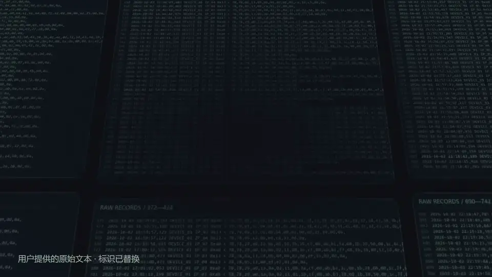

# TraceForge

TraceForge 是面向 GPS 定位设备日志排查的 Windows 桌面工具。它把分散的协议日志整理成时间轴、状态统计与 KML 轨迹，帮助 FAE、测试及联调人员快速观察设备在线状态、定位表现、ACC、告警与断联区间。

[下载 TraceForge V1.0.1](https://github.com/rockstarorz/TraceForge/releases/tag/app-v1.0.1) · [查看 V0.3.12.3 源码说明](#源码范围) · [参与维护](CONTRIBUTING.md)

## 产品预览



完整 1080p 宣传片随 [V1.0.1 Release](https://github.com/rockstarorz/TraceForge/releases/tag/app-v1.0.1) 提供下载。

## 能做什么

- 解析 Concox / GT06 设备日志
- 通过本机桥接调用 ProtocolAnalysis 处理原始服务器日志
- 汇总定位、心跳、ACC、告警、活动及登录鉴权信息
- 用统一时间轴展示数据密度和断联区间
- 按区间截取轨迹并生成 KML
- 将结果复制或交给 Google Earth 继续查看

> JT/T808 在 V1.0.1 中仍属于试验性能力，关键结论请结合原始日志复核。

## 下载与运行

1. 前往 [TraceForge V1.0.1 Release](https://github.com/rockstarorz/TraceForge/releases/tag/app-v1.0.1)。
2. 下载 `TraceForge-V1.0.1-win11.zip` 并完整解压。
3. 将公司提供的 `ProtocolAnalysis.exe` 放到 `TraceForge.exe` 同级目录。
4. 双击 `TraceForge.exe`，粘贴或导入日志后开始解析。

运行环境：Windows 11 x64。日志、解析结果与 KML 默认在本机处理。

## 源码范围

本仓库公开的是 **TraceForge V0.3.12.3（2026-09-23）源码快照**，对应原开发节点 `v0.3.12.3` / `25a8df6`。

- 仓库源码版本：V0.3.12.3
- 最新可执行版本：V1.0.1
- V1.0.1 及之后的源码：不在本仓库公开
- 本仓库没有携带原开发仓库的后续提交历史

这样安排是为了让同事可以在一个稳定、边界明确的节点上继续学习和完善，同时保持后续产品研发线独立。

## 从源码运行

应用主体使用 Flutter，官方工具桥接使用 Python。

```powershell
cd .\flutter_app
flutter pub get
flutter run -d windows
```

构建 Windows Release：

```powershell
cd .\flutter_app
flutter build windows --release
```

原始日志模式还需要同级的 `official_bridge.exe` 与公司提供的 `ProtocolAnalysis.exe`。桥接源码位于 [`official_bridge`](official_bridge)。

## 使用边界

- 不要向公开 Issue 上传客户原始日志、IMEI、位置、密钥或其他敏感信息。
- 本工具用于辅助排查，关键结论应结合设备现场信息和原始日志确认。
- 本仓库未声明通用开源许可证；源码用于内部学习、评审和协作维护，对外再分发前请联系作者。

作者：**Orion Q.**
